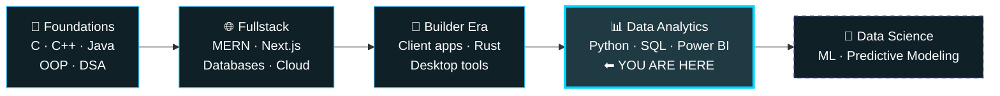

<!-- Save as README.md in a public repo named exactly like your username: AmritBakshi2003/AmritBakshi2003 -->

<div align="center">


<a href="https://git.io/typing-svg">
  
</a>

<br/><br/>

[](https://www.linkedin.com/in/amrit-bakshi-ab2a0a253/)
[](https://www.instagram.com/am_rit_bakshi/)
[](mailto:amritbakshi2003@gmail.com)


</div>

---

## 👋 About Me

I'm **Amrit Bakshi**, a developer from India who started in fullstack web development and is now **moving into Data Analytics and Data Science**. Years of building real products taught me how software works; now I'm learning how to make data tell its story.

I'm studying in college, and I keep building **web apps, websites and Windows apps** for fun and freelance work. They keep my engineering skills sharp and give me a practical edge when turning analysis into something people can actually use.

```python
class AmritBakshi:
    role       = "Aspiring Data Analyst | Ex-Fullstack Dev"
    location   = "India"
    focus      = ["Data Analytics", "Data Science", "Python", "SQL", "Power BI"]
    builder    = ["Web Apps", "Windows Tools", "Freelance Products"]
    philosophy = "Learn by building. Data matters only when it leads to a decision."
```

| | |
|:--|:--|
| 🔭 **Focus now** | Data Analytics, Data Science, Python, SQL and Power BI |
| 🛠️ **Building** | [Isle](https://github.com/AmritBakshi2003/Isle), a Tauri + Rust productivity island for Windows |
| 💬 **Ask me about** | Data analysis, the MERN stack, building and shipping side projects |
| 📫 **Open to** | Data Analytics internships, freelance projects and collabs |
| ⚡ **Fun fact** | I can build a website, analyze its traffic, and automate it, end to end |

---

## 📊 Data Projects

<table>
  <tr>
    <td width="50%" valign="top">

### 🛒 [E-commerce Sales Analysis](https://github.com/AmritBakshi2003/E-commerce_Sales_Analysis-Project)
Exploring e-commerce sales data to uncover trends and business insights that support better decisions.

    </td>
    <td width="50%" valign="top">

### 🧬 [Synthetic Data Generator v2](https://github.com/AmritBakshi2003/Synthetic-Data-Generator-v2)
A tool for generating synthetic datasets, handy for testing, prototyping and practicing analysis without real data.

    </td>
  </tr>
</table>

---

## 🚀 Apps and Builds

<table>
  <tr>
    <td width="50%" valign="top">

### 🏝️ [Isle](https://github.com/AmritBakshi2003/Isle)
A Windows always-on-top "island" utility drawer: media controls, clipboard history, tasks and calendar, app picker.


    </td>
    <td width="50%" valign="top">

### 🧮 [Calculator Suite](https://github.com/AmritBakshi2003/The_calcualtor)
Basic, scientific and financial calculators plus a scanner that reads handwritten math and solves it.

 &nbsp; [**Live demo →**](https://the-calcualtor.amritbakshi2003.workers.dev/)

    </td>
  </tr>
  <tr>
    <td width="50%" valign="top">

### 📅 [My Calender](https://github.com/AmritBakshi2003/My_Calender)
A personal calendar app to plan and organize days.

    </td>
    <td width="50%" valign="top">

### 🐍 [Snake Game](https://github.com/AmritBakshi2003/Snake-Game)
The classic arcade game, rebuilt for the fun of it.

    </td>
  </tr>
</table>

---

## 🛠️ Skills and Tech Stack

### 📊 Data Analytics


### 🤖 AI and Data


### 💻 Build Stack


<details>
<summary><b>🎨 Design and 🤝 Professional skills (click to expand)</b></summary>
<br/>


</details>

---

## 📈 My Growth Roadmap



| Stage | Focus | Status |
|:--|:--|:--|
| 🧱 **Foundations** | Programming fundamentals, OOP, problem solving | ✅ Done |
| 🌐 **Fullstack** | MERN, REST APIs, databases, deployment | ✅ Shipped projects |
| 💼 **Freelance and builds** | Client work, web and Windows apps, product thinking | 🔄 Ongoing |
| 📊 **Data Analytics** | Python, SQL, Excel, Power BI, statistics, storytelling | 🔥 Learning and building |
| 🤖 **Data Science** | Machine learning, predictive modeling | 🎯 Next up |

---

## 🎯 What Drives Me

> I learn fastest by **building real things, sharing them openly, and learning from what breaks.**

- 📊 **Data with purpose.** Analysis only matters when it leads to a decision.
- 🔨 **Builder's edge.** My development background lets me take an idea from raw data to a working tool.
- 📚 **Learn in public.** Every repo here is a lesson I'm happy to show.

---

## 📊 GitHub Stats

<div align="center">

<a href="https://github.com/AmritBakshi2003">
  <picture>
    <source media="(prefers-color-scheme: dark)" srcset="https://github-readme-stats.vercel.app/api?username=AmritBakshi2003&show_icons=true&theme=tokyonight&hide_border=true&count_private=true&include_all_commits=true" />
    
  </picture>
</a>
<a href="https://github.com/AmritBakshi2003">
  <picture>
    <source media="(prefers-color-scheme: dark)" srcset="https://github-readme-stats.vercel.app/api/top-langs/?username=AmritBakshi2003&layout=compact&theme=tokyonight&hide_border=true" />
    
  </picture>
</a>

<br/>

<picture>
  <source media="(prefers-color-scheme: dark)" srcset="https://streak-stats.demolab.com?user=AmritBakshi2003&theme=tokyonight&hide_border=true&background=00000000" />
  
</picture>

<br/>


<br/><br/>


</div>

---

## 🐍 Watch My Contributions Get Eaten

<div align="center">

<picture>
  <source media="(prefers-color-scheme: dark)" srcset="https://raw.githubusercontent.com/AmritBakshi2003/AmritBakshi2003/output/github-snake-dark.svg" />
  <source media="(prefers-color-scheme: light)" srcset="https://raw.githubusercontent.com/AmritBakshi2003/AmritBakshi2003/output/github-snake.svg" />
  
</picture>

</div>

---

## 🤝 Let's Connect

Open to **data analytics opportunities, freelance projects, and conversations** about data and web development.

<div align="center">

📫 **[amritbakshi2003@gmail.com](mailto:amritbakshi2003@gmail.com)** · 💼 **[LinkedIn](https://www.linkedin.com/in/amrit-bakshi-ab2a0a253/)** · 📸 **[Instagram](https://www.instagram.com/am_rit_bakshi/)**

*"College by day, builder by grind."*

<br/>


</div>
