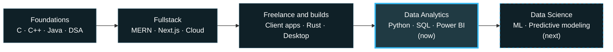

<!-- Save as README.md in a public repo named exactly like your username: AmritBakshi2003/AmritBakshi2003 -->

 

---

## About

I started in fullstack web development and am now moving into **Data Analytics and Data Science**. Building real products taught me how software works; now I'm focused on making data useful: cleaning it, analysing it, and turning it into decisions people can act on.

I'm studying in college and still build web apps, desktop tools and freelance products on the side. That engineering background lets me take an idea from raw data all the way to a working tool.

> *Learn by building. Data matters only when it leads to a decision.*

| | |
|:--|:--|
| **Focus** | Data Analytics · Python · SQL · Power BI · Statistics |
| **Building** | [Isle](https://github.com/AmritBakshi2003/Isle), a productivity island for Windows (Tauri + Rust) |
| **Next** | Machine learning and predictive modeling |
| **Open to** | Data Analytics internships, freelance projects and collaborations |

---

## Featured Projects

<table>
<tr>
<td width="50%" valign="top">

#### [E-commerce Sales Analysis](https://github.com/AmritBakshi2003/E-commerce_Sales_Analysis-Project)
Analysis of e-commerce sales data to uncover trends and business insights that support better decisions.

</td>
<td width="50%" valign="top">

#### [Synthetic Data Generator v2](https://github.com/AmritBakshi2003/Synthetic-Data-Generator-v2)
Generates synthetic datasets for testing, prototyping and practising analysis without real data.

</td>
</tr>
<tr>
<td width="50%" valign="top">

#### [Isle](https://github.com/AmritBakshi2003/Isle)
Always-on-top Windows utility drawer with media controls, clipboard history, tasks, calendar and an app picker.

</td>
<td width="50%" valign="top">

#### [Calculator Suite](https://github.com/AmritBakshi2003/The_calcualtor)
Basic, scientific and financial calculators, plus a scanner that reads handwritten math and solves it. &nbsp;[Live demo](https://the-calcualtor.amritbakshi2003.workers.dev/)

</td>
</tr>
</table>

More on my [repositories page](https://github.com/AmritBakshi2003?tab=repositories), including a calendar app and a snake game.

---

## Skills

| | |
|:--|:--|
| **Data** |       |
| **Frontend** |         |
| **Backend** |      |
| **Databases** |      |
| **Cloud and tools** |       |
| **Design** |      |

**Working style:** requirement gathering · client communication · project planning · stakeholder management · team leadership · cross-functional collaboration

---

## Career Path

---

## GitHub Activity

<picture>
  <source media="(prefers-color-scheme: dark)" srcset="https://github-readme-stats.vercel.app/api?username=AmritBakshi2003&show_icons=true&theme=tokyonight&hide_border=true" />
  
</picture>
<picture>
  <source media="(prefers-color-scheme: dark)" srcset="https://github-readme-stats.vercel.app/api/top-langs/?username=AmritBakshi2003&layout=compact&theme=tokyonight&hide_border=true" />
  
</picture>

 

<picture>
  <source media="(prefers-color-scheme: dark)" srcset="https://raw.githubusercontent.com/AmritBakshi2003/AmritBakshi2003/output/github-snake-dark.svg" />
  <source media="(prefers-color-scheme: light)" srcset="https://raw.githubusercontent.com/AmritBakshi2003/AmritBakshi2003/output/github-snake.svg" />
  
</picture>

---

### Let's work together

Open to data analytics opportunities, freelance projects, and conversations about data and web development.

**[amritbakshi2003@gmail.com](mailto:amritbakshi2003@gmail.com)** · **[LinkedIn](https://www.linkedin.com/in/amrit-bakshi-ab2a0a253/)**

 

